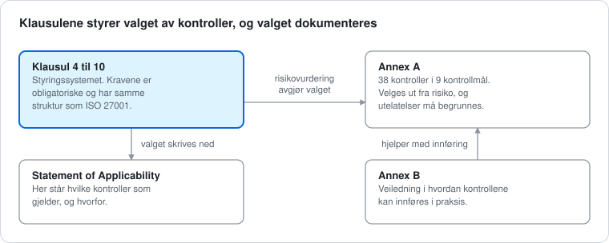

# ISO/IEC 42001 forklart

En norsk studieguide om ISO/IEC 42001, standarden for hvordan en organisasjon styrer bruk av kunstig intelligens (AI). Guiden viser hvordan standarden er bygget opp, hva Annex A inneholder og hvordan en organisasjon kommer fra risikovurdering til sertifikat. Fagordene er forklart i en ordliste først i guiden.

## Innhold

| Del | Hva du finner |
|---|---|
| [Hele guiden](docs/iso-42001-forklart.md) | Ordliste, oversikt, kapittel 4 til 10, de 38 tiltakene i Annex A, veien til sertifikat, hvilke versjoner som gjelder nå, sammenheng med ISO 27001, NIST AI RMF og EU AI Act, et eksempel og vanlige misforståelser |
| [assets](assets) | De tre tegningene som brukes i guiden |

## Hvem den er for

Studenter og nybegynnere innen GRC og informasjonssikkerhet som vil forstå hvordan AI-styring fungerer i praksis.

## Hva dette ikke er

- Ikke en offisiell tolkning. Guiden bygger på åpne kilder og ikke på selve standarden, som er betalt.
- Ikke juridisk rådgivning.
- Tall og tiltaksnumre bør sjekkes mot den offisielle teksten på iso.org.
- Standarder og regler endrer seg. Guiden er sist oppdatert 25. oktober 2026.

## Kilder

Se kildelisten nederst i [guiden](docs/iso-42001-forklart.md).

## Om meg

Laget av [Speed-boo3](https://github.com/Speed-boo3) som en del av studiene mine i cybersikkerhet.
