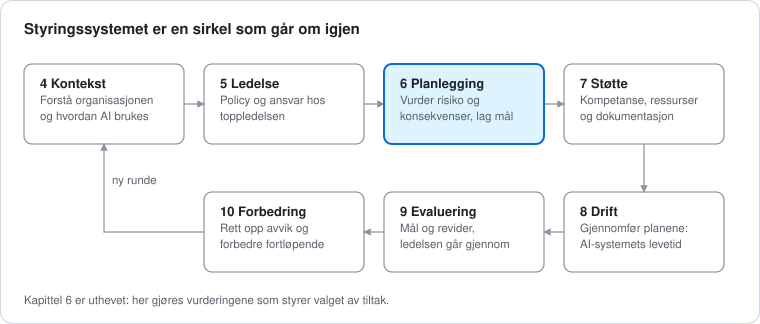

# ISO/IEC 42001: slik fungerer standarden for AI-styring

*Sist oppdatert 25. oktober 2026*

ISO/IEC 42001 er en standard for hvordan en organisasjon kan styre bruk og utvikling av kunstig intelligens (AI) på en ansvarlig måte. Den er bygget opp som ISO 27001, men handler om AI i stedet for informasjonssikkerhet.

## Ordliste

Standarder bruker mange fagord. Her er de du trenger i denne guiden.

| Ord | Hva det betyr |
| --- | --- |
| Standard | En avtalt oppskrift som mange organisasjoner følger |
| Styringssystem | Reglene, rollene og rutinene en organisasjon bruker for å styre noe, her AI |
| Kapittel (klausul) | Et nummerert kapittel i standarden. I faget heter de klausuler. Kapittel 4 til 10 inneholder kravene |
| Annex | Et vedlegg bak i standarden |
| Tiltak (kontroll) | Noe konkret organisasjonen gjør for å redusere risiko, for eksempel en regel eller en rutine. Standarden kaller dem kontroller |
| Område (kontrollmål) | En gruppe tiltak som hører sammen |
| Risiko | Hvor sannsynlig det er at noe går galt, og hvor ille det blir |
| Konsekvensvurdering | En vurdering av hvordan et AI-system kan påvirke mennesker og samfunnet |
| Statement of Applicability (SoA) | Et dokument som viser hvilke tiltak som gjelder, og hvorfor |
| Revisjon (audit) | En gjennomgang som sjekker at man faktisk gjør det man sier |
| Sertifisering | Bekreftelse fra et uavhengig organ på at man oppfyller standarden |

## Oversikt

Standarden har to deler som jobber sammen. Kapittel 4 til 10 er kravene: de beskriver hvordan organisasjonen styrer AI, hvem som bestemmer, hvordan risiko vurderes og hvordan arbeidet følges opp. Annex A er en liste med 38 tiltak man velger fra. Standarden er bygget opp som andre ISO-standarder for styringssystemer, blant annet ISO 27001, så de to kan bygges sammen.

Kapitlene avgjør hvilke tiltak i Annex A som blir aktuelle, og valget skrives ned i en Statement of Applicability (SoA). Annex B forklarer hvordan tiltakene kan gjøres om til praksis.

## Kravene: kapittel 4 til 10

Kapittel 4 til 10 er kjernen i standarden og må følges. De går i en sirkel: man forstår situasjonen, planlegger, gjennomfører, måler og forbedrer, og så begynner man på nytt.

Slik leser du kapitlene i praksis:

| Kapittel | Tema | Hva det betyr i praksis |
| --- | --- | --- |
| 4 | Kontekst | Forstå organisasjonen, hva de som berøres forventer, hvilke regler som gjelder og hva styringssystemet skal dekke |
| 5 | Ledelse | Toppledelsen bestemmer AI-policy (reglene for AI), fordeler ansvar og sørger for ressurser |
| 6 | Planlegging | Vurdere risiko og konsekvenser av AI-systemene, sette mål og planlegge tiltak |
| 7 | Støtte | Sørge for kompetanse, kommunikasjon og dokumentasjon |
| 8 | Drift | Gjøre det man har planlagt gjennom hele AI-systemets levetid, fra data og utvikling til bruk, overvåking og avvikling |
| 9 | Evaluering | Måle hvordan det går, gjennomføre interne revisjoner og la ledelsen gå gjennom resultatene |
| 10 | Forbedring | Rette opp avvik og hendelser, og forbedre fortløpende |

Beskrivelsene bygger på [Compliance Councils oversikt](https://compliancecouncil.com.au/standards/iso-42001/). Den offisielle teksten ligger hos ISO.

## Annex A: de 38 tiltakene

Annex A er en liste man velger fra, ikke en sjekkliste man må krysse av på alt. Organisasjonen velger de tiltakene som passer risikoen sin, og må forklare hvorfor den utelater de andre. Det største området er A.6 om AI-systemets levetid, med 9 tiltak.

| Område | Tema | Antall | Hva det handler om |
| --- | --- | --- | --- |
| A.2 | Regler for AI | 3 | En AI-policy, at den passer sammen med andre regler, og at den gås gjennom jevnlig |
| A.3 | Hvem gjør hva | 2 | Roller og ansvar, og en måte å si fra om bekymringer |
| A.4 | Det AI-systemet bruker | 5 | Oversikt over data, verktøy, datakraft og kompetanse |
| A.5 | Konsekvenser | 4 | Hvordan AI-systemer kan påvirke enkeltpersoner, grupper og samfunnet. Veiledning i metoden finnes i ISO/IEC 42005 |
| A.6 | AI-systemets levetid | 9 | Krav, design, testing, innføring, drift, overvåking og logging |
| A.7 | Data | 5 | Kvalitet, opphav og klargjøring av data |
| A.8 | Informasjon til dem som berøres | 4 | Dokumentasjon for brukere, mulighet til å melde fra utenfra og varsling om hendelser |
| A.9 | Bruk | 3 | Regler for ansvarlig bruk, og at systemet bare brukes til det det er godkjent for |
| A.10 | Leverandører og kunder | 3 | Hvem som har ansvar for hva, og hvordan leverandører og kunder følges opp |
| | **Sum** | **38** | |

Tabellen bygger på [Risk Professionals](https://riskprofs.com/iso-42001-annex-a-controls-list/). En annen kilde jeg så oppgir 39 tiltak, så sjekk tallet i selve standarden før du bruker det i en søknad.

## Fra risiko til sertifikat

En organisasjon starter ikke med tiltakene, men med risikoen. Først avgrenser den hva styringssystemet skal dekke, kartlegger AI-systemene og vurderer risiko og konsekvenser. Først etter det velger den tiltak fra Annex A.

Sertifikatet gjelder typisk i tre år, med årlige oppfølgingsrevisjoner. Organet som reviderer må følge ISO/IEC 42006, som setter egne krav til dem som reviderer og sertifiserer AI-styringssystemer.

### Statement of Applicability (SoA)

I steg 4 skriver organisasjonen ned valget i en Statement of Applicability, ofte kalt SoA. Den viser alle tiltakene i Annex A, om de gjelder, og hvorfor. Et tiltak skal ikke utelates bare fordi det er vanskelig eller dyrt. Begrunnelsen må bygge på avgrensningen, risikoen, lovkrav og det organisasjonen allerede har på plass.

| Felt i SoA | Hva som føres inn |
| --- | --- |
| Tiltak | Hvilket tiltak det gjelder, for eksempel A.6.2.6 |
| Gjelder? | Ja, nei eller delvis |
| Begrunnelse | Hvorfor tiltaket er valgt eller utelatt |
| Risikoer | Hvilke risikoer tiltaket skal redusere |
| Status | Planlagt, pågår, delvis eller ferdig |
| Ansvarlig | Hvem som eier tiltaket |
| Bevis | Policyer, rutiner, systemer og logger som viser at det virker |
| Neste gjennomgang | Når valget skal vurderes på nytt |

En svak begrunnelse sier bare at tiltaket ikke er relevant. En god begrunnelse forklarer hva organisasjonen gjør med AI, hvilke risikoer den har og hvem som har ansvaret. Kilder: [Risk Professionals](https://riskprofs.com/iso-42001-annex-a-controls-list/) og [Compliance Council](https://compliancecouncil.com.au/standards/iso-42001/).

## Hvilke versjoner gjelder nå

Her er status per 25. oktober 2026 for rammeverkene i guiden.

| Rammeverk | Gjeldende versjon | Merknad |
| --- | --- | --- |
| ISO/IEC 42001 | 42001:2023 | Utgave 1, publisert desember 2023. Ingen ny utgave er publisert. En kursleverandør venter en revisjon, kanskje i 2027, men det er en vurdering og ikke et vedtak |
| ISO/IEC 27001 | 27001:2022 med endring 1 fra 2024 | Endringen legger til klimaspørsmål i kapittel 4. Det finnes ingen 2026-utgave. Overgangen fra 2013-utgaven tok slutt 31. oktober 2025 |
| ISO/IEC 42005 | 42005:2025 | Veiledning for konsekvensvurdering av AI-systemer, publisert mai 2025 |
| ISO/IEC 42006 | 42006:2025 | Krav til organer som reviderer og sertifiserer AI-styringssystemer, publisert juli 2025 |
| NIST AI RMF | 1.0 fra januar 2023 | Under revisjon. En profil for generativ AI kom 26. juli 2024, og 7. april 2026 la NIST fram et konseptnotat for en profil for kritisk infrastruktur |
| EU AI Act | Endret av forordning 2026/1744 (Digital Omnibus) | Trådte i kraft 27. juli 2026. Se fristene lenger ned |

Standarder og regler endrer seg. Sjekk iso.org og nist.gov før du skriver et årstall eller en versjon i en søknad.

## Sammenhengen med andre rammeverk og regler

ISO 42001 står ikke alene. Den har mest til felles med ISO 27001, og den brukes ofte sammen med NIST AI RMF og som støtte når man forbereder seg på EU AI Act.

| Rammeverk | Hva det er | Forholdet til ISO 42001 |
| --- | --- | --- |
| ISO 27001 | Standard for informasjonssikkerhet med 93 tiltak i fire temaer (utgave 2022) | Samme oppbygging, så de kan bygges sammen. Et ISO 27001-sertifikat oppfyller likevel ikke 42001 automatisk, for AI har egne krav til blant annet konsekvensvurdering og bruk |
| NIST AI RMF | Frivillig rammeverk fra NIST med funksjonene Govern, Map, Measure og Manage | En naturlig kombinasjon: AI RMF som veiledning i risikoarbeidet, ISO 42001 som styringssystem man kan sertifiseres mot |
| EU AI Act | Lov som regulerer AI etter risikonivå | ISO 42001 kan gi struktur for dokumentasjon og styring, men er ikke i seg selv bevis på at loven er oppfylt |

Kolonnen om forholdet er delvis min egen vurdering, og delvis hentet fra kildene under.

### EU AI Act: fristene per oktober 2026

- **Høyrisiko, selvstendige systemer** (for eksempel AI i ansettelser, utdanning og kredittvurdering): 2. desember 2027, utsatt fra 2. august 2026.
- **Høyrisiko, systemer bygget inn i produkter** (for eksempel medisinsk utstyr og maskiner): 2. august 2028.
- **Åpenhetskrav** (si fra at man snakker med AI, merke deepfakes): gjelder fra 2. august 2026. Visse krav til maskinlesbar merking for generativ AI som allerede var på markedet har en kort overgang.
- **Regler for store, generelle AI-modeller** er ikke utsatt.

Hvordan AI Act blir en del av norsk rett har jeg ikke sjekket, så se regjeringen.no før du skriver noe om det i en søknad. Kilder: [NIST AI RMF](https://www.nist.gov/itl/ai-risk-management-framework), [K&L Gates via Mondaq](https://www.mondaq.com/eu-digital-omnibus-on-ai-enters-into-force/1825722), [Risk Professionals](https://riskprofs.com/iso-42001-annex-a-controls-list/) og [Compliance Council](https://compliancecouncil.com.au/standards/iso-42001/).

## Eksempel: et lite firma med en chatbot

Tenk deg et konsulentfirma med 20 ansatte. Det har en chatbot på nettsiden, bruker et verktøy til å sortere jobbsøknader, og noen ansatte limer tekst inn i et offentlig AI-verktøy. Eksempelet er oppdiktet og viser tankegangen, det er ikke et fasitsvar.

| AI-bruk | Hva kan gå galt | Områder som blir aktuelle |
| --- | --- | --- |
| Chatbot på nettsiden | Gir kunder feil svar, eller kundedata havner i samtalen | A.7 data, A.8 informasjon til brukerne om at de snakker med AI, A.9 bruk, A.10 leverandøren av modellen |
| Sortering av jobbsøknader | Utvalget favoriserer noen grupper uten at noen oppdager det | A.5 konsekvenser for enkeltpersoner og grupper, A.6 testing og kontroll av at systemet fungerer, A.7 datakvalitet, A.9 at et menneske følger med |
| Ansatte bruker offentlige AI-verktøy | Fortrolig informasjon forlater firmaet | A.2 AI-policy, A.9 regler for ansvarlig bruk, A.4 oversikt over hvilke verktøy som brukes |

Firmaet bygger ingen egne modeller. Derfor kan noen tiltak om egenutvikling være lite aktuelle. Det må i så fall begrunnes i SoA, og områdene om bruk og leverandører blir desto viktigere.

## Vanlige misforståelser

- **«Alle 38 tiltakene må innføres.»** Nei. Organisasjonen velger ut fra risiko og må begrunne det den utelater.
- **«Dette gjelder bare de som lager AI.»** Nei. Standarden gjelder også organisasjoner som bruker AI, for eksempel chatboter eller analyseverktøy.
- **«Gode dokumenter er nok.»** Nei. Revisorer ser etter bevis for at tiltakene virker i praksis, ikke bare at policyen finnes.
- **«ISO 27001 dekker AI også.»** Nei. AI har egne krav, for eksempel konsekvensvurdering, datakvalitet og regler for bruk.
- **«Sertifisering betyr at loven er oppfylt.»** Nei. Standarden er et verktøy, ikke et lovkrav, og den erstatter ikke vurdering av AI Act.

## Kilder

Sidene jeg har åpnet og lest:

- [Risk Professionals: ISO 42001 Annex A Controls List](https://riskprofs.com/iso-42001-annex-a-controls-list/): områder, antall tiltak, Statement of Applicability og sammenligning med ISO 27001. Konsulentselskap.
- [Compliance Council: ISO/IEC 42001](https://compliancecouncil.com.au/standards/iso-42001/): kapittel 4 til 10, sertifiseringsprosess og tidsbruk. Konsulentselskap.
- [NIST: AI Risk Management Framework](https://www.nist.gov/itl/ai-risk-management-framework): funksjoner, frivillig bruk, utgivelsesdato og revisjon.
- [K&L Gates via Mondaq: EU Digital Omnibus on AI Enters Into Force](https://www.mondaq.com/eu-digital-omnibus-on-ai-enters-into-force/1825722), 3. august 2026: nye frister i AI Act.
- [deGRANDSON: ISO Management System Standards Revisions 2026-2030](https://www.degrandson.com/blog/iso-management-system-standards-revisions-2026-2030), status 24. september 2026: gjeldende utgaver og forventede revisjoner. Kursleverandør, så uttalelsen om en kommende 42001-revisjon er deres vurdering.
- [ISO: ISO/IEC 27001:2022/Amd 1:2024](https://www.iso.org/standard/88435.html): endring 1, publisert februar 2024.

Fra ISOs egne sider har jeg bare lest utdrag i søkeresultater, siden nettstedet blokkerte åpning av sidene: [ISO/IEC 42005:2025](https://www.iso.org/standard/44545.html) og [ISO/IEC 42006:2025](https://www.iso.org/standard/42006).

Selve ISO-standarden har jeg ikke lest, siden den er betalt. Sjekk alle tall og tiltaksnumre mot den offisielle teksten på iso.org før du bruker dem i en søknad eller et intervju.
