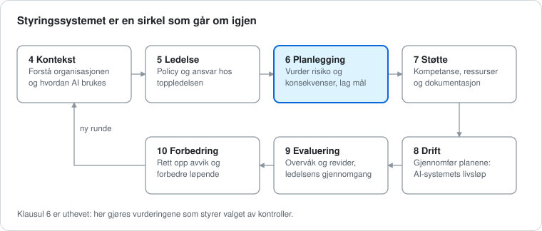
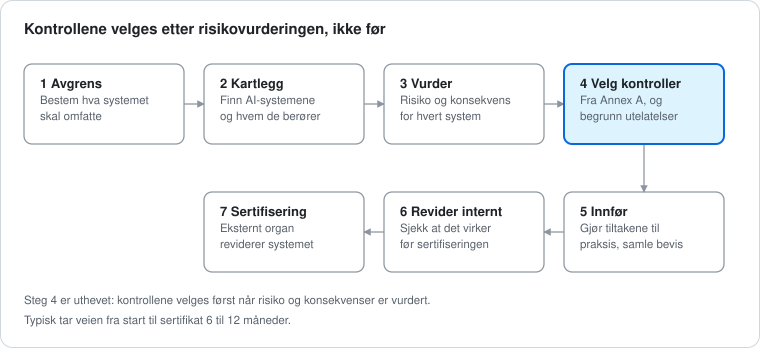

# ISO/IEC 42001: slik fungerer standarden for AI-styring

*Sist oppdatert 23. oktober 2026*

ISO/IEC 42001 er standarden for å styre bruk og utvikling av kunstig intelligens på en ansvarlig og dokumentert måte. Den er bygget på samme måte som ISO 27001, men handler om AI i stedet for informasjonssikkerhet.

## Oversikt

Standarden har to deler som jobber sammen. Klausul 4 til 10 beskriver hvordan en organisasjon styrer AI: hvem som bestemmer, hvordan risiko vurderes og hvordan arbeidet følges opp. Annex A er en liste med 38 kontroller man velger fra. Standarden har samme overordnede struktur som andre ISO-ledelsessystemer, blant annet ISO 27001, så de to kan bygges sammen.

Det er klausulene som avgjør hvilke kontroller i Annex A som blir aktuelle, og valget skrives ned i en Statement of Applicability. Annex B hjelper med å gjøre kontrollene om til praksis.

## Styringssystemet: klausul 4 til 10

Klausulene er kjernen i standarden og må følges. De går i en sirkel: man forstår situasjonen, planlegger, gjennomfører, måler og forbedrer, og så begynner man på nytt.

Slik leser du klausulene i praksis:

| Klausul | Tema | Hva det betyr i praksis |
| --- | --- | --- |
| 4 | Kontekst | Forstå organisasjonen, hva interessentene forventer, hvilke regler som gjelder og hva styringssystemet skal omfatte |
| 5 | Ledelse | Toppledelsen setter AI-policy, fordeler ansvar og sikrer ressurser |
| 6 | Planlegging | Vurdere risiko og konsekvenser av AI-systemene, sette mål og planlegge tiltak |
| 7 | Støtte | Sikre kompetanse, kommunikasjon og dokumentasjon |
| 8 | Drift | Gjennomføre planene gjennom AI-systemets livsløp, fra data og modellutvikling til drift, overvåking og avvikling |
| 9 | Evaluering | Overvåke ytelse, gjennomføre interne revisjoner og ledelsens gjennomgang |
| 10 | Forbedring | Håndtere avvik og hendelser, rette dem opp og forbedre løpende |

Beskrivelsene bygger på [Compliance Councils oversikt](https://compliancecouncil.com.au/standards/iso-42001/). Den offisielle teksten ligger hos ISO.

## Annex A: de 38 kontrollene

Annex A er et referansesett, ikke en sjekkliste man må krysse av i sin helhet. Organisasjonen velger de kontrollene som passer risikoen sin, og må begrunne de den utelater. Størst er A.6 om livsløpet, med 9 kontroller.

| Kontrollmål | Tema | Antall | Hva det handler om |
| --- | --- | --- | --- |
| A.2 | Policyer for AI | 3 | AI-policy, samsvar med andre policyer og regelmessig gjennomgang |
| A.3 | Intern organisering | 2 | Roller og ansvar, og en måte å melde fra om bekymringer |
| A.4 | Ressurser til AI-systemer | 5 | Oversikt over data, verktøy, infrastruktur og kompetanse som brukes |
| A.5 | Vurdering av konsekvenser | 4 | Hvordan AI-systemer kan påvirke enkeltpersoner, grupper og samfunnet |
| A.6 | AI-systemets livsløp | 9 | Krav, design, testing, innføring, drift, overvåking og logging |
| A.7 | Data til AI-systemer | 5 | Kvalitet, opphav og klargjøring av data |
| A.8 | Informasjon til berørte parter | 4 | Dokumentasjon for brukere, ekstern rapportering og varsling om hendelser |
| A.9 | Bruk av AI-systemer | 3 | Regler for ansvarlig bruk, og at systemet brukes til det det er godkjent for |
| A.10 | Tredjeparter og kunder | 3 | Ansvarsfordeling, leverandører og kunder |
| | **Sum** | **38** | |

Tabellen bygger på [Risk Professionals](https://riskprofs.com/iso-42001-annex-a-controls-list/). En annen kilde jeg så oppgir 39 kontroller, så sjekk tallet i selve standarden før du bruker det i en søknad.

## Fra risiko til sertifikat

En organisasjon starter ikke med kontrollene, men med risikoen. Først avgrenser den hva styringssystemet skal dekke, kartlegger AI-systemene og vurderer risiko og konsekvenser. Først etter det velger den kontroller fra Annex A.

Sertifikatet gjelder typisk i tre år, med årlige oppfølgingsrevisjoner.

### Statement of Applicability

I steg 4 skriver organisasjonen ned valget i en Statement of Applicability (SoA). Den viser alle kontrollene i Annex A, om de gjelder, og hvorfor. En kontroll skal ikke utelates bare fordi den er vanskelig eller dyr. Begrunnelsen må bygge på omfang, risiko, lovkrav og det organisasjonen allerede har på plass.

| Felt i SoA | Hva som føres inn |
| --- | --- |
| Kontrollreferanse | Hvilken kontroll det gjelder, for eksempel A.6.2.6 |
| Gjelder? | Gjelder, utelatt eller delvis |
| Begrunnelse | Hvorfor kontrollen er valgt eller utelatt |
| Relaterte risikoer | Hvilke risikoer kontrollen skal håndtere |
| Status | Planlagt, pågår, delvis eller innført |
| Ansvarlig | Rollen som eier kontrollen |
| Bevis | Policyer, prosedyrer, systemer og logger som viser at den virker |
| Neste gjennomgang | Når valget skal vurderes på nytt |

En svak begrunnelse sier at kontrollen ikke er relevant. En god begrunnelse forklarer hva organisasjonen gjør med AI, hvilke risikoer den har og hvem som har ansvaret. Kilder: [Risk Professionals](https://riskprofs.com/iso-42001-annex-a-controls-list/) og [Compliance Council](https://compliancecouncil.com.au/standards/iso-42001/).

## Sammenhengen med andre rammeverk og regler

ISO 42001 står ikke alene. Den har mest til felles med ISO 27001, og den brukes ofte sammen med NIST AI RMF og som støtte når man forbereder seg på EU AI Act.

| Rammeverk | Hva det er | Forholdet til ISO 42001 |
| --- | --- | --- |
| ISO 27001 | Standard for informasjonssikkerhet med 93 kontroller i fire temaer | Samme overordnede struktur, så de kan bygges sammen. Et ISO 27001-sertifikat oppfyller likevel ikke 42001 automatisk, for AI har egne krav til blant annet konsekvensvurdering og bruk |
| NIST AI RMF | Frivillig rammeverk fra NIST med funksjonene Govern, Map, Measure og Manage. Utgitt 26. januar 2023 og under revisjon | En naturlig kombinasjon: AI RMF som veiledning i risikoarbeidet, ISO 42001 som styringssystem man kan sertifiseres mot |
| EU AI Act | Lov som regulerer AI etter risikonivå | ISO 42001 kan gi struktur for dokumentasjon og styring, men er ikke i seg selv bevis på at loven er oppfylt |

Kolonnen om forholdet er delvis min egen vurdering, og delvis hentet fra kildene under.

### EU AI Act: fristene per oktober 2026

- **Høyrisiko, selvstendige systemer** (for eksempel AI i ansettelser, utdanning og kredittvurdering): 2. desember 2027, utsatt fra 2. august 2026.
- **Høyrisiko, systemer bygget inn i produkter** (for eksempel medisinsk utstyr og maskiner): 2. august 2028.
- **Åpenhetskrav** (opplyse om at man snakker med AI, merke deepfakes): gjelder fra 2. august 2026. Visse krav til maskinlesbar merking for generativ AI som allerede var på markedet har en kort overgang.
- **Regler for generelle AI-modeller** er ikke utsatt.

Utsettelsen kom med forordning 2026/1744, som trådte i kraft 27. juli 2026. Hvordan AI Act blir en del av norsk rett har jeg ikke sjekket, så se regjeringen.no før du skriver noe om det i en søknad. Kilder: [NIST AI RMF](https://www.nist.gov/itl/ai-risk-management-framework), [K&L Gates via Mondaq](https://www.mondaq.com/eu-digital-omnibus-on-ai-enters-into-force/1825722), [Risk Professionals](https://riskprofs.com/iso-42001-annex-a-controls-list/) og [Compliance Council](https://compliancecouncil.com.au/standards/iso-42001/).

## Eksempel: et lite firma med en chatbot

Tenk deg et konsulentfirma med 20 ansatte. Det har en chatbot på nettsiden, bruker et verktøy til å sortere jobbsøknader, og noen ansatte limer tekst inn i et offentlig AI-verktøy. Eksempelet er oppdiktet og viser tankegangen, det er ikke et fasitsvar.

| AI-bruk | Hva kan gå galt | Kontrollmål som blir aktuelle |
| --- | --- | --- |
| Chatbot på nettsiden | Gir kunder feil svar, eller kundedata havner i samtalen | A.7 data, A.8 informasjon til brukerne om at de snakker med AI, A.9 bruk, A.10 leverandøren av modellen |
| Sortering av jobbsøknader | Utvalget favoriserer noen grupper uten at noen oppdager det | A.5 konsekvenser for enkeltpersoner og grupper, A.6 testing og validering, A.7 datakvalitet, A.9 menneskelig kontroll |
| Ansatte bruker offentlige AI-verktøy | Fortrolig informasjon forlater firmaet | A.2 AI-policy, A.9 regler for ansvarlig bruk, A.4 oversikt over hvilke verktøy som brukes |

Firmaet bygger ingen egne modeller. Derfor kan noen kontroller om egenutvikling være lite aktuelle. Det må i så fall begrunnes i Statement of Applicability, og kontrollene om bruk og leverandører blir desto viktigere.

## Vanlige misforståelser

- **«Alle 38 kontrollene må innføres.»** Nei. Organisasjonen velger ut fra risiko og må begrunne det den utelater.
- **«Dette gjelder bare de som lager AI.»** Nei. Standarden gjelder også organisasjoner som bruker AI, for eksempel chatboter eller analyseverktøy.
- **«Gode dokumenter er nok.»** Nei. Revisorer ser etter bevis for at kontrollene virker i praksis, ikke bare at policyen finnes.
- **«ISO 27001 dekker AI også.»** Nei. AI har egne krav, for eksempel konsekvensvurdering, datakvalitet og regler for bruk.
- **«Sertifisering betyr at loven er oppfylt.»** Nei. Standarden er et verktøy, ikke et lovkrav, og den erstatter ikke vurdering av AI Act.

## Kilder

Dette er sidene som er åpnet og brukt. De to første er kommersielle konsulentselskaper, ikke ISO selv.

- [Risk Professionals: ISO 42001 Annex A Controls List](https://riskprofs.com/iso-42001-annex-a-controls-list/): kontrollmål, antall kontroller, Statement of Applicability og sammenligning med ISO 27001.
- [Compliance Council: ISO/IEC 42001](https://compliancecouncil.com.au/standards/iso-42001/): klausul 4 til 10, sertifiseringsprosess og tidsbruk.
- [NIST: AI Risk Management Framework](https://www.nist.gov/itl/ai-risk-management-framework): funksjoner, frivillig bruk og utgivelsesdato.
- [K&L Gates via Mondaq: EU Digital Omnibus on AI Enters Into Force](https://www.mondaq.com/eu-digital-omnibus-on-ai-enters-into-force/1825722), 3. august 2026: nye frister i AI Act.

Selve ISO-standarden er ikke lest, siden den er betalt. Sjekk alle tall og kontrollnummer mot den offisielle teksten på iso.org før du bruker dem i en søknad eller et intervju.
